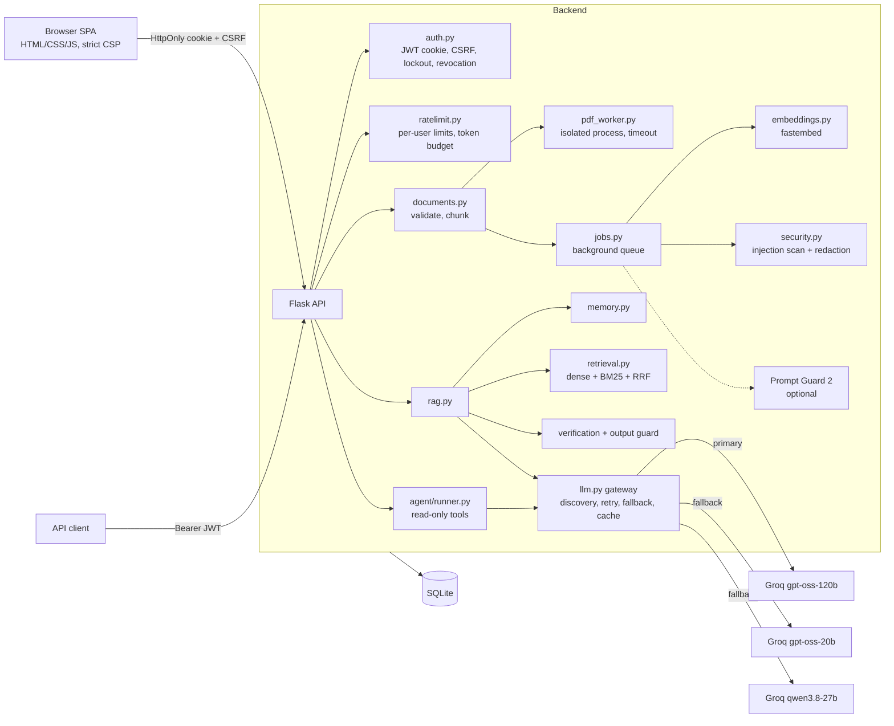

# Architecture

## Request flows
**Upload** → rate limit + quota → validate (extension, magic bytes, active-content PDF) → SHA-256 duplicate check →
save → background: extract (PDF in child process) → chunk → embed → injection scan (regex/normalization + optional
classifier) → store chunks with reasons → `ready`/`failed`.

**RAG** → rate limit + token budget → follow-up scoping → query rewrite → hybrid retrieval → relevance gate →
context built with suspicious sentences redacted → grounded JSON answer → citation normalization/validation →
output guard → LLM verification.

**Agent** → whitelisted read-only tools → argument validation → per-tool timeout → max steps → forced final answer.

## Model strategy
| Model | Role |
|---|---|
| `openai/gpt-oss-120b` | primary (`reasoning_effort=low`) |
| `openai/gpt-oss-20b` | fallback 1 |
| `qwen/qwen3.8-27b` | fallback 2, different family (preview; `reasoning_format=hidden`) |

Unavailable models are detected via `GET /models`; `model_not_found` disables a model; `json_validate_failed`
retries without strict JSON mode.

## Key decisions
| Decision | Why | Trade-off |
|---|---|---|
| Cookie session + CSRF instead of localStorage token | token unreachable by injected JS | CSRF handling needed |
| Redact (not drop) injected sentences | keeps the legitimate facts of a poisoned document | regex can miss paraphrased attacks |
| PDF parsing in child process | malicious PDF can't hang/exhaust the server | ~0.5–1 s spawn overhead per PDF |
| SQLite-backed rate limits | survive restarts, no Redis | single instance |
| Read-only agent tools | prompt injection can't escalate to actions | agent can't take actions |
| Local fastembed embeddings | Groq has no embeddings API | ~130 MB model |
